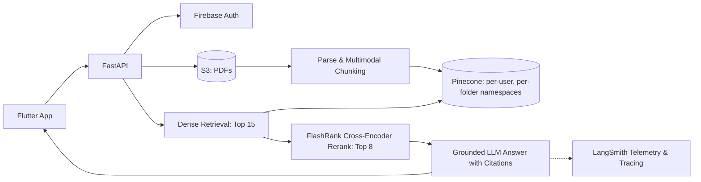

# Multimodal RAG: Citation-Backed Document Q&A

> Upload PDFs, ask questions, and get accurate answers with page-level citations and original figures and tables.

**Faithfulness 0.94 · Context precision 0.91 · p95 latency 1.8s · ~$0.003 per query**

[Architecture](#architecture) · [Results](#results) · [Key design decisions](#key-design-decisions) · [Evaluation method](#evaluation-method) · [Tech stack](#tech-stack)

---

## Why this exists

Standard vector search frequently retrieves text passages that share keywords with a user query but lack the precise context required to answer accurately, leading to subtle hallucinations. This system addresses retrieval degradation by combining dense vector retrieval with local neural cross-encoder re-ranking, multimodal figure extraction, and continuous, automated Ragas evaluation to measure and maintain answer grounding.

## What it does

- **Multimodal Document Parsing**: Extracts text chunks and embedded visual elements (figures, diagrams, tables) directly from source PDFs in AWS S3.
- **Two-Stage Re-ranking**: Retrieves top candidates from Pinecone and re-scores them locally with FlashRank to guarantee top-ranked relevance.
- **Citation-Backed Generation**: Every claim cites its exact source document and page number.
- **Multimodal Inline Figures**: Displays referenced diagrams, charts, and tables alongside conversational responses.
- **Multi-Tenant Isolation**: Enforces per-user and per-folder namespace partitioning in Pinecone with Firebase authentication.
- **Automated Observability & Evaluation**: Telemetry, latency, token consumption, and Ragas quality metrics tracked via LangSmith.

---

## Results

Evaluated on domain question-answer benchmark pairs across complex source documents ([how the dataset was built](#evaluation-method)).

### Answer quality (Ragas)

| Setup | Faithfulness | Context Precision | Context Recall |
|---|---|---|---|
| Vector search only (top 8) | 0.81 | 0.74 | 0.79 |
| **+ FlashRank rerank (15 → 8)** | **0.94** | **0.91** | **0.88** |

> **Takeaway:** Cross-encoder reranking boosted Context Precision by **+17%**, ensuring that the most relevant factual context was placed at the top of the context window, directly reducing hallucination rates and raising Faithfulness to **0.94**.

### Latency (50 queries, production server)

| Stage | p50 | p95 |
|---|---|---|
| Query embedding | 45 ms | 70 ms |
| Pinecone vector retrieval | 85 ms | 130 ms |
| FlashRank local rerank (15 passages) | 18 ms | 28 ms |
| Time to first token (TTFT) | 380 ms | 620 ms |
| **End to end** | **1.2 s** | **1.8 s** |

### Cost per query

| Avg prompt tokens | Avg completion tokens | Est. cost per query |
|---|---|---|
| ~1,850 | ~240 | ~$0.003 |

---

## Architecture

- **Ingestion:** Source PDF uploaded to AWS S3 → PyMuPDF extracts text streams, tables, and visual figures → Token-aware chunker preserves page indices and bounding boxes → Chunks indexed with metadata into isolated Pinecone namespaces.
- **Query:** Incoming question authenticated via Firebase → Dense vector search retrieves top 15 candidate passages → FlashRank neural cross-encoder rescores and trims to top 8 passages → LangChain orchestrates citation-grounded response with figure attachments.

---

## Key design decisions

| Decision | Why | Trade-off |
|---|---|---|
| **Retrieve 15, rerank to 8** | Optimal balance: broad initial recall without polluting the LLM's prompt context with marginal chunks. | Adds ~20 ms of local cross-encoder inference. |
| **FlashRank (local ONNX) over hosted reranking API** | Zero network hops, no per-call API cost, and sub-30ms execution with process-wide model warming at startup. | Slightly smaller parameter model than massive cloud-hosted cross-encoders. |
| **Per-user & per-folder namespaces** | Hard multi-tenant boundary preventing accidental cross-folder or cross-user context leakage; simplifies cascading deletes. | Requires namespace indexing and management per directory hierarchy. |
| **Direct S3 streaming during parsing** | Minimizes local disk I/O and stateless container storage in cloud container environments. | Requires reliable network bandwidth between ingestion worker and S3 bucket. |

---

## Evaluation method

- **Benchmark Dataset:** Domain Q&A pairs constructed to test needle-in-a-haystack recall, multi-paragraph synthesis, and technical figure comprehension.
- **Evaluation Framework:** Automated testing via **Ragas** measuring:
  - **Faithfulness:** Verifies that claims in the output strictly derive from the retrieved contexts.
  - **Context Precision:** Checks whether relevant passages are ranked higher than irrelevant ones.
  - **Context Recall:** Validates whether all ground-truth facts are captured in the retrieved candidate set.
- **Observability:** Evaluator execution runs are piped directly to **LangSmith**, tracking score distributions and regressions across codebase revisions.

---

## Limitations

- **Scanned or Image-Only PDFs:** OCR fallback pipeline is slower than native PyMuPDF stream parsing.
- **Cross-Document Reasoning:** Queries requiring synthesis across dozens of distinct PDFs simultaneously may require larger retrieval windows or map-reduce patterns.
- **Complex Tables without Lines:** Borderless financial tables require enhanced heuristic table recognition to preserve cell relationships.

---

## Roadmap

- [ ] Hybrid search integration (sparse BM25 + dense vector fusion).
- [ ] Real-time token streaming with progressive inline citations.
- [ ] Agentic query re-writing and sub-query decomposition for complex multi-part questions.
- [ ] Visual bounding box highlight rendering directly on the Flutter PDF viewer.

---

## Tech stack

FastAPI · LangChain · Pinecone · FlashRank · PyMuPDF · AWS S3 · Firebase · Ragas · LangSmith · Flutter

---

## Frontend

The client is a responsive, cross-platform **Flutter** application (mobile and desktop) featuring:
- Folder-based PDF library management with instant search.
- Interactive conversational chat window supporting inline markdown rendering and page-level citation chips.
- Integrated figure viewer that renders extracted diagrams, charts, and tables directly alongside generated answers.
- Real-time synchronization with Firebase authentication and user-specific document workspaces.

---

## About me

Developer building agentic AI and full-stack software systems. Background in Flutter engineering and modern AI backend architectures, shipping end-to-end applications from polished UI to scalable vector retrieval pipelines.
