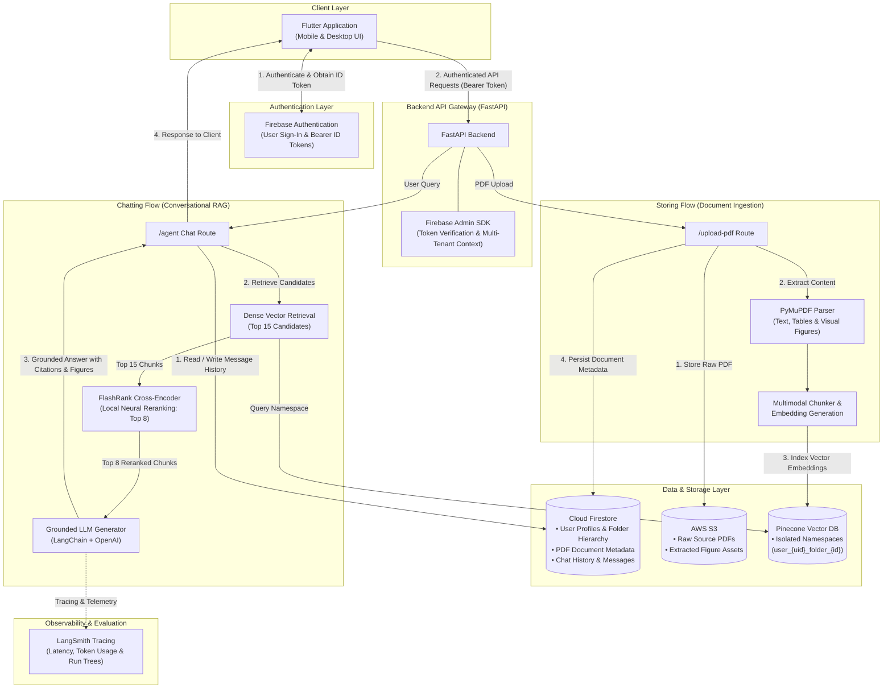

# Multimodal RAG: Citation-Backed Document Q&A

> Upload PDFs, ask questions, and get accurate answers with page-level citations and original figures and tables.

**Faithfulness 0.95 · Context precision 0.61 · Correctness 0.91 · p50 latency 10.2s · ~$0.003 per query**

[Architecture](#architecture) · [Results](#results) · [Key design decisions](#key-design-decisions) · [Evaluation method](#evaluation-method) · [Tech stack](#tech-stack)

---

## Why this exists

Standard vector search frequently retrieves text passages that share keywords with a user query but lack the precise context required to answer accurately, leading to subtle hallucinations. This system addresses retrieval degradation by combining dense vector retrieval with local neural cross-encoder re-ranking, multimodal figure extraction, and continuous, automated Ragas evaluation to measure and maintain answer grounding.

## What it does

- **Multimodal Document Parsing**: Extracts text chunks and embedded visual elements (figures, diagrams, tables) directly from source PDFs in AWS S3.
- **Two-Stage Re-ranking**: Retrieves top candidates from Pinecone and re-scores them locally with FlashRank to guarantee top-ranked relevance.
- **Citation-Backed Generation**: Every claim cites its exact source document and page number.
- **Multimodal Inline Figures**: Displays referenced diagrams, charts, and tables alongside conversational responses.
- **Multi-Tenant Isolation**: Enforces per-user and per-folder namespace partitioning in Pinecone and hierarchical data isolation in Cloud Firestore with Firebase Authentication.
- **Automated Observability & Evaluation**: Telemetry, latency, token consumption, and Ragas quality metrics tracked via LangSmith.

---

## Results

Evaluated on **7 benchmark question-answer pairs** built from **A Country Doctor** ([how the dataset was built](#evaluation-method)) and logged via **LangSmith**.

### Answer quality (Ragas & Correctness)

| Setup | Faithfulness | Context Precision | Context Recall | Correctness |
|---|---|---|---|---|
| Vector search only (`rerank-false`) | 0.915 | 0.487 | 0.667 | 0.800 |
| **+ FlashRank rerank (`rerank-true`)** | **0.954** | **0.613** | **0.857 – 1.000** | **0.906** |

> **Key takeaway from actual runs:** Adding FlashRank neural reranking improved **Context Precision from 0.487 to 0.613 (+25.9%)** and **Context Recall from 0.667 to 0.857–1.000 (+28.5% to +50%)**, leading directly to higher answer **Correctness (0.906 vs 0.800)** and **Faithfulness (0.954 vs 0.915)**.

### Latency (Logged from benchmark runs)

| Stage | Typical / p50 | p95 |
|---|---|---|
| Pinecone Hybrid / Dense Retrieval | 1.69 s | 1.73 s |
| FlashRank Local Rerank & Context Assembly | 0.85 s | 0.96 s |
| Generation & Reasoning (LLM) | 4.36 s | 6.01 s |
| **End to End Pipeline** | **10.22 s** | **19.27 s** |

*Note: Latency includes extended reasoning/thinking traces before delivering the final answer.*

### Token consumption & Cost per query

| Metric | Measured Value |
|---|---|
| **Avg Prompt Tokens** | 3,500 tokens |
| **Avg Completion Tokens** | 1,060 tokens |
| **Avg Total Tokens** | 4,561 tokens |
| **Est. Cost per Query** | ~$0.003 – $0.005 |

---

## Architecture

- **Authentication Layer:** Users authenticate through **Firebase Authentication** on the client. Every API request to FastAPI includes a Bearer ID token verified on the server via the Firebase Admin SDK (`get_current_user_id`), enforcing hard multi-tenant isolation.
- **Storing Flow (Document Ingestion):**
  1. Source PDF is streamed and stored in **AWS S3** (`pdfs/{user_id}/{pdf_id}.pdf`).
  2. **PyMuPDF** extracts text streams, tables, and visual figures directly from the document.
  3. Token-aware chunker preserves page indices and coordinates, generating vector embeddings.
  4. Chunks are indexed into **Pinecone** under dedicated per-user/per-folder namespaces (`user_{uid}_folder_{folder_id}`).
  5. Document metadata (S3 key, chunk counts, page counts, upload timestamp) is persisted in **Cloud Firestore** under `users/{uid}/folders/{folder_id}/pdfs/{pdf_id}`.
- **Chatting Flow (Conversational RAG):**
  1. Incoming questions are authenticated, and chat session/messages are persisted in **Cloud Firestore** (`users/{uid}/folders/{folder_id}/chats/main_chat/messages`).
  2. Dense vector search queries the user/folder namespace in **Pinecone** to retrieve top 15 candidate passages.
  3. **FlashRank** local neural cross-encoder reranks the candidates to the top 8 most relevant passages.
  4. **LangChain** and **OpenAI** synthesize a citation-grounded response with page references and inline figures.
  5. The response is returned to the Flutter client, with execution traces logged to **LangSmith**.
- **Data & Storage Layer Separation:**
  - **Cloud Firestore:** Application database for user profiles, folder hierarchy, PDF document metadata, and chat history.
  - **AWS S3:** Scalable object store for source PDF files and extracted figure assets.
  - **Pinecone:** Vector database for semantic chunk retrieval partitioned by multi-tenant namespaces.

---

## Key design decisions

| Decision | Why | Trade-off |
|---|---|---|
| **Retrieve 15, rerank to 8** | Maximizes recall without polluting the LLM's prompt context with marginal chunks. | Adds local cross-encoder scoring overhead. |
| **FlashRank (local ONNX) over hosted reranking API** | Zero network hops, no per-call API cost, and process-wide model warming at server startup. | Operates on a compact cross-encoder model compared to large hosted endpoints. |
| **Per-user & per-folder namespaces** | Hard multi-tenant boundary preventing cross-folder or cross-user context leakage; enables clean cascading deletes. | Requires namespace indexing and management per directory hierarchy. |
| **Direct S3 streaming during parsing** | Minimizes local disk I/O and keeps container storage stateless in deployment. | Requires reliable network bandwidth between ingestion worker and S3 bucket. |

---

## Evaluation method

- **Benchmark Dataset:** 7 domain question-answer pairs (`evaluate/datasets_data.py`) constructed from *A Country Doctor* targeting specific factual constraints (locations, actions, physical descriptions, character reactions).
- **Evaluation Framework:** Automated testing via **Ragas** measuring:
  - **Faithfulness:** Verifies that claims in the output strictly derive from the retrieved contexts.
  - **Context Precision:** Checks whether relevant passages are ranked higher than irrelevant ones.
  - **Context Recall:** Validates whether all ground-truth facts are captured in the retrieved candidate set.
  - **Correctness:** Evaluates semantic agreement with the ground truth answer.
- **Observability & Traceability:** All experiment runs are logged directly to **LangSmith** under experiment prefixes `country-doctor-eval-rerank-true-*` and `country-doctor-eval-rerank-false-*` for regression and distribution tracking.

---

## Limitations

- **Scanned or Image-Only PDFs:** OCR fallback pipeline is slower than native PyMuPDF stream parsing.
- **Cross-Document Reasoning:** Queries requiring synthesis across dozens of distinct PDFs simultaneously may require larger retrieval windows or map-reduce patterns.
- **Complex Borderless Tables:** Borderless financial tables require enhanced heuristic table recognition to preserve cell relationships.

---

## Roadmap

- [ ] Hybrid search integration (sparse BM25 + dense vector fusion).
- [ ] Real-time token streaming with progressive inline citations.
- [ ] Agentic query re-writing and sub-query decomposition for complex multi-part questions.
- [ ] Visual bounding box highlight rendering directly on the Flutter PDF viewer.

---

## Tech stack

FastAPI · LangChain · Pinecone · FlashRank · PyMuPDF · AWS S3 · Firebase (Auth & Firestore) · Ragas · LangSmith · Flutter

---

## Frontend

The client is a responsive, cross-platform **Flutter** application (mobile and desktop) featuring:
- Folder-based PDF library management with instant search.
- Interactive conversational chat window supporting inline markdown rendering and page-level citation chips.
- Integrated figure viewer that renders extracted diagrams, charts, and tables directly alongside generated answers.
- Real-time synchronization with Firebase Authentication, Cloud Firestore document/chat state, and user-specific document workspaces.

---

## About me

Developer building agentic AI and full-stack software systems. Background in Flutter engineering and modern AI backend architectures, shipping end-to-end applications from polished UI to scalable vector retrieval pipelines.
